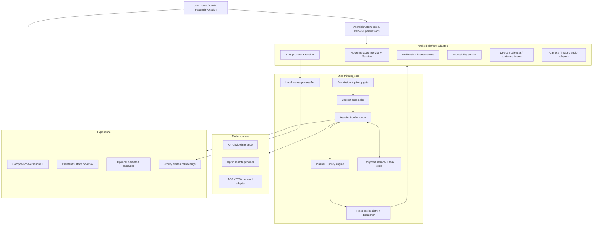

# Miss Minutes — Jarvis-Class Android Architecture

**Status:** Architecture baseline / implementation contract  
**Date:** 2026-11-18  
**Repository baseline:** `main` at `6125902c16c3d0a5f1737bedc0955762c319fa5e`  
**Product target:** An Android-native personal assistant named Miss Minutes, inspired by the *capability class* of JARVIS. This is an engineering target, not a claim that Android can expose every fictional capability.

## 1. Product contract

Miss Minutes is not a chat app with a wake phrase. It is a user-owned, permission-governed system assistant that combines:

1. **Always-available invocation:** selected Android Assistant role, system-managed voice-interaction lifecycle, hardware hotword detection when the device supports it, and explicit fallback invocation when it does not.
2. **Conversational intelligence:** streaming dialogue, multilingual understanding (Tajik, Russian, English), intent decomposition, bounded planning, tool selection, execution feedback, and recovery.
3. **Device agency:** typed Android actions for apps, settings, alarms, calendar, contacts, files, media, navigation hand-off, and supported system controls.
4. **Communication intelligence:** SMS, notification triage, contact context, caller/call hand-off, message drafting and policy-bounded sending.
5. **Context awareness:** current foreground app, user-shared screen context, selected documents/images, time, calendar and user-approved location context.
6. **Long-term assistance:** encrypted local memory, preferences, routines, reminders, task state, and explainable proactive suggestions.
7. **Multimodal interaction:** speech input/output, optional camera/image understanding, visual assistant UI and an optional animated character.
8. **Reliability and control:** visible state, permission health, audit history, cancellation, user override, privacy controls, offline degradation and deterministic safety boundaries.

### Capability boundary

The product should reproduce useful *functional analogues* of JARVIS, not promise fictional omniscience. A normal Android app cannot silently bypass permissions, root protections, secure windows, other apps' private databases, carrier restrictions, or the user's decisions. Accessibility automation only works where an app exposes accessible controls. Hardware hotwording depends on the device's voice-interaction and DSP capabilities. These limits are product requirements, not bugs to work around.

## 2. Current baseline — facts, not assumptions

The current repository already contains useful foundations:

- Jetpack Compose application shell and multilingual UI.
- Direct DeepSeek provider abstraction, speech input/output, encrypted conversation storage and bounded tool execution.
- Declarative plugin registry, consent/access checks, audit log and allowlisted device tools.
- Accessibility-based cross-app inspection and interaction.
- A user-started on-device speech-recognition foreground service.
- Backup/restore foundations and a floating launcher overlay.

The baseline is **not yet a Jarvis-class Android assistant**:

- There is no `VoiceInteractionService`, `VoiceInteractionSessionService` or Assistant-role onboarding.
- There is no SMS receiver, SMS provider integration, inbox synchronizer or SMS classifier wired into Android.
- There is no `NotificationListenerService` implementation.
- The current wake-word implementation continuously restarts `SpeechRecognizer` in a microphone foreground service; it is not Android's system-managed hotword pipeline.
- The main Compose screen currently owns too many unrelated responsibilities and needs feature boundaries.
- Exact-head CI at the repository baseline is red: `ProductIdentityTest` and `WakePhraseMatcherTest` fail. These must be repaired before relying on subsequent test evidence.

## 3. Target architecture

Use a modular, domain-first architecture. Android framework services are adapters; product logic stays in deterministic, testable Kotlin components.



### Dependency rules

- UI depends on use cases, never directly on Android services or provider SDKs.
- Domain logic depends on interfaces, not Android framework classes.
- Platform adapters implement narrowly scoped interfaces.
- AI models propose actions; only the compiled policy engine can authorize and dispatch them.
- Plugins are metadata plus compiled handlers. No downloaded executable plugin code, arbitrary shell, reflection-based execution or model-generated Kotlin/Java.
- All persistent user data passes through repositories with explicit retention and encryption policy.

### Suggested package/module boundaries

Start with Gradle modules only when a boundary is stable; create packages first to avoid a premature module explosion.

| Boundary | Responsibility |
|---|---|
| `core:domain` | Assistant state, intents, plans, tasks, message models, policies |
| `core:orchestrator` | Dialogue and task orchestration, streaming, cancellation, recovery |
| `core:security` | Permission snapshots, consent, action risk, audit redaction |
| `core:memory` | Encrypted local memory, preferences, conversation and task persistence |
| `core:ai` | Provider-neutral model API, routing, token/context budgets, structured tool calls |
| `core:tools` | Typed capability catalog, schemas, dispatcher, rate limits |
| `feature:voice` | Wake invocation, ASR, dialogue turns, TTS and audio focus |
| `feature:communications` | SMS, notification triage, contact resolution, call hand-off |
| `feature:automation` | Accessibility workflows, app intents, UI state and action verification |
| `feature:proactive` | Reminders, routines, calendar signals and priority briefings |
| `feature:perception` | User-triggered image, camera and screen-context analysis |
| `feature:avatar` | Optional 2D/3D character rendering and animation state |
| `platform:android` | Role, lifecycle, permission, service and framework implementations |
| `app` | Composition root, navigation, settings and dependency wiring |

## 4. Android system integration — the key architectural decision

### 4.1 Make Miss Minutes the real system Assistant

Implement `VoiceInteractionService` and its session service, publish the required service metadata, qualify for `RoleManager.ROLE_ASSISTANT`, and request the role through Android's user-consent screen. Check role availability and role ownership at runtime; never assume either. On API levels where the role is unavailable, expose a clearly labeled, reduced-capability `ACTION_ASSIST` fallback.

Android documents that the user's selected `VoiceInteractionService` is kept running by the system so it can support background hotword invocation. The service must remain lightweight; heavyweight work belongs in the interaction session. This is the correct foundation for continuous assistant availability, rather than trying to keep a normal Activity or arbitrary microphone service alive forever.

### 4.2 Hotword strategy

- **Primary:** system hotword pipeline through the voice-interaction APIs and hardware/DSP support where available, with explicit enrollment and system-visible controls.
- **Fallback:** a user-started, disclosed microphone foreground service only when the system hotword path is unavailable or unsupported.
- **Never claim:** universal always-on hotword support on every Android phone, guaranteed survival through every OEM battery policy, or hidden microphone capture.
- The assistant must show an unmistakable listening state and provide an immediate stop control.

### 4.3 SMS role and policy

- Implement the assistant role before requesting SMS permissions.
- Check `RoleManager.isRoleAvailable(ROLE_ASSISTANT)` and `isRoleHeld(ROLE_ASSISTANT)`; request it only through the system confirmation UI.
- Request only the specific SMS permissions needed after the user has chosen Miss Minutes as Assistant and after the purpose is explained.
- Use an SMS broadcast receiver for new-message events and a repository synchronizer for permitted inbox reads. Deduplicate by stable provider identity; handle multipart messages, duplicate broadcasts, SIM/device restarts and permission revocation.
- Android 17 (API 37) delays SMS availability for most apps that target API 37 unless they qualify for an exemption such as the default SMS assistant app. This reinforces implementing the actual Assistant role; reading SMS notifications alone is not equivalent to reading the SMS inbox.
- Google Play treats SMS permissions as restricted sensitive permissions. Default Assistant handling is an eligible use case, subject to review and the app's declared core functionality. The app must stop accessing this data if it loses the qualifying role.
- If Play distribution is not viable, a sideload build may still be constrained by Android role and runtime rules; distribution does not remove platform security.

### 4.4 Notifications and cross-app context

Implement `NotificationListenerService` separately from SMS. Ask the user to enable Notification Access in system settings. Apply package-level allow/deny controls, redact notification content in logs, and let the user exclude apps. Notifications are not a substitute for the SMS provider.

Accessibility remains a separate, user-enabled capability. Inspect the active window only when an invocation or approved workflow needs it; do not continuously harvest screens. Respect secure windows, password fields, app boundaries and explicit user denial. Use app intents and official APIs before accessibility heuristics.

## 5. SMS intelligence pipeline

```text
SMS system event
  -> permission/role check
  -> parse + deduplicate
  -> local encrypted inbox record
  -> deterministic local classifier
  -> priority queue
  -> alert / daily briefing / searchable history
  -> optional assistant explanation
```

### Classification classes

- **Critical:** suspected fraud, account compromise, explicit urgent/emergency message.
- **High:** bank transaction, payment/debit notification, verification code, security warning, trusted contact marked important by the user.
- **Normal:** personal and service messages without urgent indicators.
- **Low:** routine service notices and marketing.
- **Junk:** high-confidence scam/spam indicators.

Each classification returns a category, confidence/score and safe reason codes — never the raw OTP value in analytics or logs. Unknown and ambiguous messages remain visible in the normal/review inbox; classification never silently deletes or hides them.

### Local-first privacy

- Sender and body stay on-device by default.
- First pass uses deterministic rules; a later small on-device model may improve ranking after device benchmarks.
- No raw SMS content is uploaded to a cloud model by default.
- Remote analysis requires a separate, clearly scoped opt-in and a per-message preview or a user-configured policy.
- OTPs, bank account fragments and authentication links are always redacted from telemetry.
- The user can pause triage, exclude senders/apps, delete local history and revoke permissions.
- Never auto-forward SMS or make financial decisions based only on model classification.

### Message sending policy

A direct user command to send an ordinary message can be executed without a repetitive confirmation after the required Android grants are in place. First-time role/permission setup still requires system consent. Unknown recipients, ambiguous contact matches, bulk messages, OTP sharing, money transfers, account/security changes and other high-impact actions require a stronger confirmation or are blocked. Incoming-message triage itself never sends replies autonomously unless the user configures a narrowly scoped, revocable rule.

## 6. Agent runtime — a plan is not permission

Every assistant turn follows a controlled state machine:

1. Capture the request and only the context needed for the task.
2. Resolve identity, language, app and entities; ask a focused question only when ambiguity affects the action.
3. Build a bounded plan with explicit preconditions and expected outcomes.
4. Match proposed tools against the compiled capability catalog.
5. Check current OS grants, app consent, role status, risk tier, rate limit and execution budget.
6. Execute one bounded action at a time; verify the observed result.
7. Continue, recover or stop. Never pretend an action succeeded without evidence.
8. Store only useful, user-approved memory and a privacy-redacted audit event.

### Risk tiers

| Tier | Examples | Policy |
|---|---|---|
| Read-only | Time, battery, permitted inbox summary, visible screen labels | Execute within granted scope |
| Reversible | Open app, scroll, set a draft reminder | Execute if user asked; undo where supported |
| Ordinary communication | Send a simple user-requested SMS to a uniquely resolved contact | Execute after prior permissions and configured send policy |
| Consequential | Financial transaction, purchase, public post, bulk send, account change | Explicit just-in-time confirmation |
| Prohibited | Bypass OS security, exfiltrate secrets, access another user's data | Block and explain |

The policy engine, not the language model, enforces these tiers. Every mutating operation has an idempotency key, bounded timeout, cancellation path and verifiable result.

## 7. Intelligence and memory

### Model routing

- Local deterministic logic handles permissions, classification, safety, routing, simple intents and routine commands.
- A supported on-device LLM is the default privacy-preserving option when installed and within memory/latency budget.
- An optional cloud provider handles tasks that benefit from larger reasoning models, only when the user has configured a key or explicit provider connection.
- The orchestrator chooses the smallest capable runtime; provider failure degrades gracefully to local commands.
- Tool calls use JSON/schema validation and strict maximum rounds, context length, output tokens and execution time.
- No provider can override permissions, risk policy or user preferences.

### Memory layers

- **Working context:** current turn and current workflow, short-lived.
- **Episodic memory:** user-approved summaries of past interactions and completed tasks.
- **Semantic preferences:** language, preferred contacts, routines, common destinations and interaction preferences.
- **Operational state:** reminders, pending actions, idempotency keys and workflow checkpoints.

Store locally with Android Keystore-backed encryption. Exclude credentials, API keys, raw OTPs, full SMS bodies and permissions from backups. Memory must be inspectable, editable and deletable by the user.

## 8. Experience and multimodal surface

- A fast chat/voice surface remains the primary control center.
- A system Assistant session provides global invocation without needing the app's main Activity.
- A compact overlay is optional and user-started; it must not obstruct other apps or impersonate Android system UI.
- TTS is interruptible and respects audio focus, silent mode and foreground/lifecycle policy.
- Camera and screen interpretation are user-triggered or explicitly session-authorized, with an indicator and a stop control.
- The Miss Minutes animated character is a presentation layer over the same assistant state machine. It must not become a separate source of truth or consume memory continuously.
- Tajik, Russian and English are first-class product languages across UI, speech, classification, messages and errors.

## 9. Performance, security and quality gates

Target the Galaxy A35 class device first, then widen the compatibility matrix. Eight GB RAM is not eight GB available to one model: Android, UI, ASR, TTS and camera pipelines compete for memory.

- Keep the Assistant service small; move model inference and heavy work out of it.
- Use streaming and cancellable jobs; do not load multi-gigabyte model weights into the hotword service.
- Benchmark cold/warm latency, memory peak, battery drain, thermals and background recovery on physical hardware.
- Bound stored history; paginate inbox and conversation UI; avoid full-table reads on startup.
- Use Room/SQLite for structured state, Keystore-backed encryption for secrets and WorkManager for deferrable sync/maintenance (not for real-time hotword or SMS broadcast handling).
- Run JVM tests for domain policy, Android instrumentation for roles/services/permissions, emulator compatibility tests and physical-device acceptance tests.
- Security pipeline: dependency review, secret scanning, static analysis, release signing outside source control, SBOM and checksum evidence.

### Definition of done for a capability

A capability is not complete because a button or tool exists. It is complete only when:
- it has a real Android adapter and a documented permission path;
- role loss, permission denial, reboot, process death and cancellation are handled;
- positive, negative, boundary and abuse-case tests exist;
- the user sees what data is accessed and how to disable it;
- success is based on a verified platform result;
- physical-device behavior has been tested where hardware/lifecycle matters.

## 10. Roadmap calibrated to a $10,000 engineering standard

The $10,000 figure is used here as a **scope and quality benchmark**, not a claim that funds were received or spent. The allocation below represents the engineering attention that a serious commissioned build should reserve for each area.

| Workstream | Allocation | Expected outcome |
|---|---:|---|
| Product architecture, threat model and platform contracts | $650 | Approved system architecture, ADRs and acceptance criteria |
| System Assistant, voice interaction and hotword | $1,450 | Role onboarding, system-managed service/session, reliable voice path and fallback |
| Dialogue engine, planner and model orchestration | $1,350 | Streaming conversation, bounded planning, local/cloud routing and tool execution |
| Android device capabilities and cross-app automation | $1,350 | Typed, tested system actions and verified accessibility workflows |
| SMS, notifications and communication intelligence | $1,250 | Assistant-qualified SMS access, inbox sync, local triage, notification listener and safe send |
| Memory, personalization and proactive routines | $1,100 | Encrypted memory, calendar/task context, reminders and briefings |
| Multimodal perception and vision | $850 | User-triggered camera/image/screen understanding with privacy controls |
| UI, overlay, voice identity and avatar | $750 | Polished multilingual interface, optional character and interruptible TTS |
| Security, privacy and reliability hardening | $650 | Threat controls, audit redaction, permission lifecycle and failure recovery |
| QA, physical-device validation and release engineering | $600 | CI gates, A35 test matrix, signed release procedure and reproducible artifacts |
| **Total** | **$10,000** | **A release-quality Android assistant, not a mock demo** |

### Delivery phases and exit gates

| Phase | Deliverables | Exit gate |
|---|---|---|
| P0 — Stabilize | Repair failing baseline tests, freeze contracts, threat model, domain boundaries | CI green on exact main head |
| P1 — System Assistant | Assistant role request, VoiceInteractionService/session, system invocation and capability diagnostics | Role/lifecycle tests pass; device invocation verified |
| P2 — Communications | SMS role/permissions, broadcast ingestion, inbox sync, local classifier, notification listener | SMS survives process death/reboot; duplicates and revocation tested |
| P3 — Agent core | Intent router, planner, typed tools, risk policy, action verification and cancellation | Tool safety and end-to-end orchestration tests pass |
| P4 — Device agency | App intents, Accessibility automation, calendar, contacts, alarms, settings and files | Real actions verified on A35; inaccessible UI fails safely |
| P5 — Personal intelligence | Encrypted memory, contact importance, routines, calendar-aware reminders and briefings | Data lifecycle and privacy tests pass |
| P6 — Multimodal AI | Local model runtime, cloud opt-in, camera/image and screen context | Memory/thermal/latency budgets pass on target hardware |
| P7 — Character experience | Voice personality, polished overlay and optional rigged animated avatar | UI remains responsive and assistant logic independent |
| P8 — Release hardening | Security audit, localization audit, test matrix, signed APK and release evidence | No critical/high unresolved findings; install/upgrade/uninstall verified |

### Immediate implementation order

1. Fix the two already-failing unit tests and restore a green baseline.
2. Land this architecture contract and the first pure-domain SMS classifier with tests.
3. Introduce Assistant role and VoiceInteractionService/session as a separate, reversible integration.
4. Implement SMS and notification platform adapters only after the role/permission lifecycle is verified.
5. Migrate the monolithic UI and existing device plugins incrementally behind the domain interfaces; do not throw away working code just to rename folders.

No phase is declared complete until its exit gate passes. Emulator success is not physical Galaxy A35 proof. An unsigned CI APK is not a production release.
